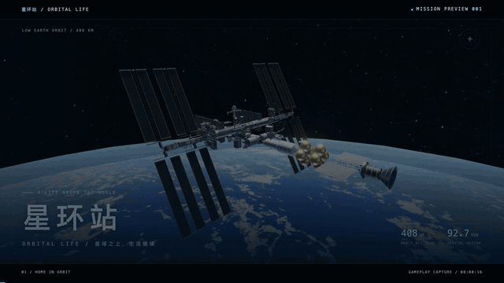
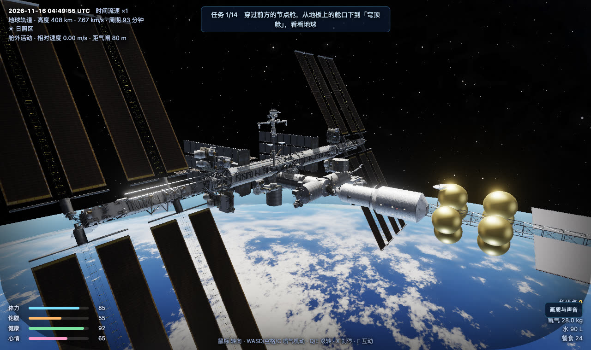
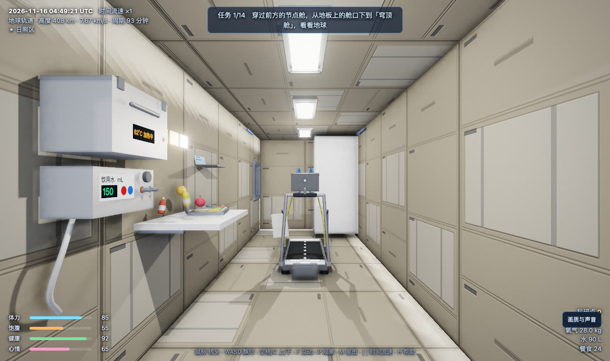
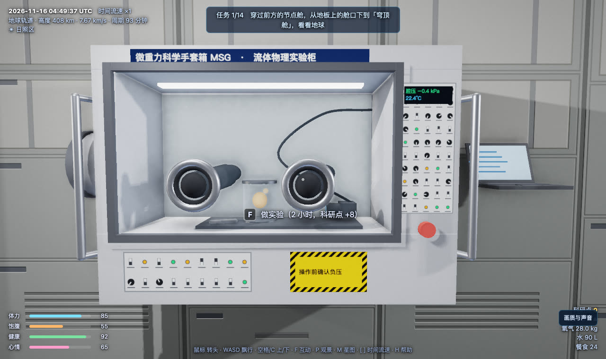
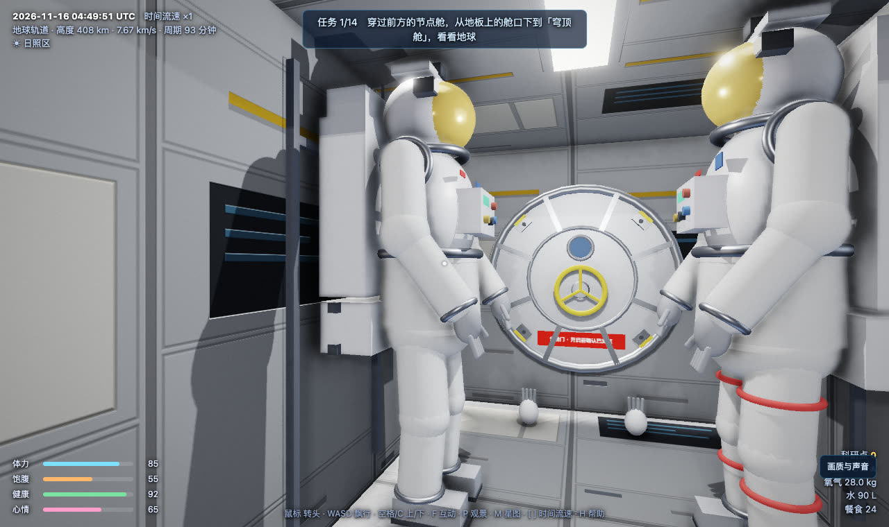
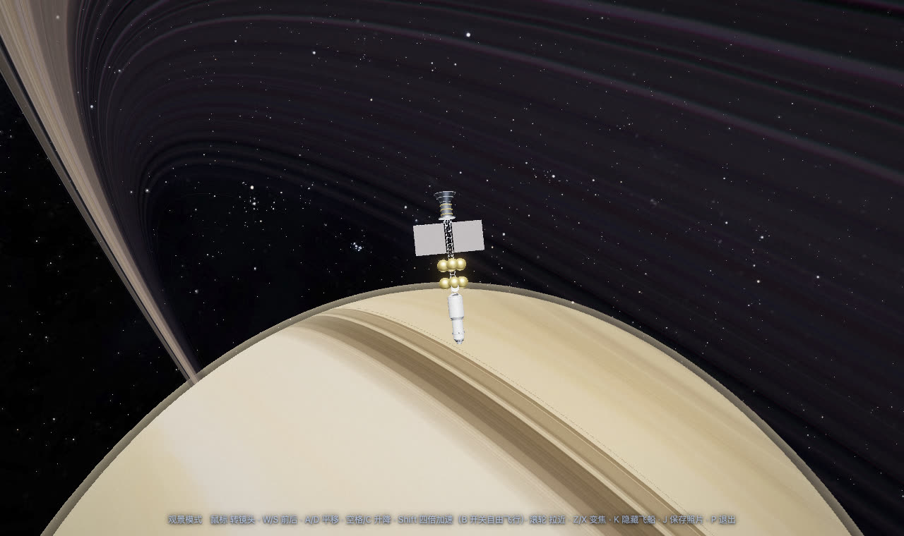
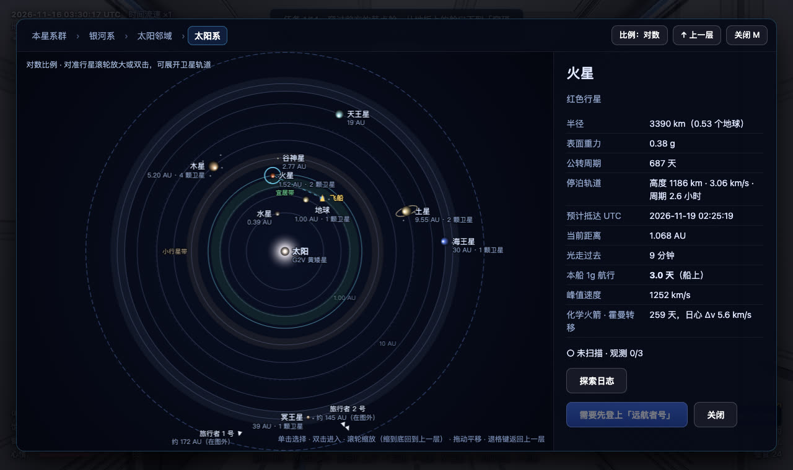
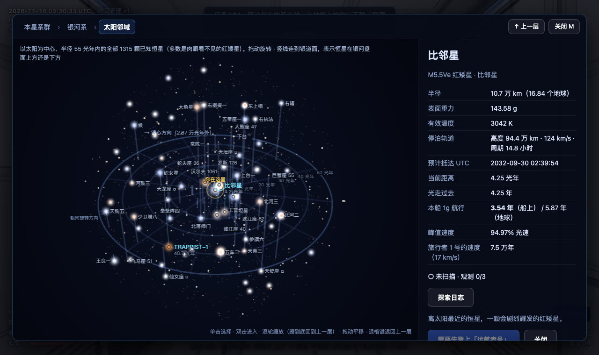
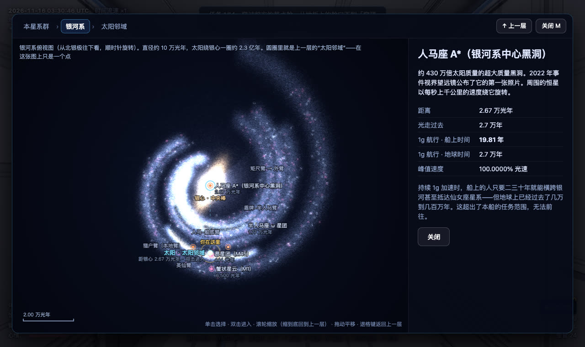
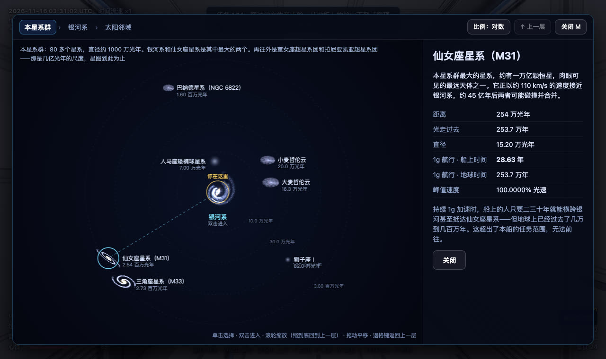

<div align="center">

# 星环站 · Orbital Life

**在浏览器里的 3D 空间站生活与太空航行游戏**

住进近地轨道 408 公里的空间站，在失重中吃饭、种菜、做实验、出舱维修；<br>
再驾驶聚变飞船「远航者号」飞往月球、土星，乃至 40 光年外的 TRAPPIST-1。

[**▶ 在线试玩**](https://zoroperona.github.io/space-station-life/) · [下载最新版本](https://github.com/zoroperona/space-station-life/releases/latest) · [观看演示视频](https://zoroperona.github.io/space-station-life/docs/media/demo.mp4)

<a href="https://zoroperona.github.io/space-station-life/docs/media/demo.mp4"></a>

<sub>点击动图观看完整演示视频（52 秒，有配乐）。画面均为游戏内实时渲染。</sub>

</div>

---

## 快速开始

| 方式 | 步骤 |
| --- | --- |
| **在线玩** | 打开 [zoroperona.github.io/space-station-life](https://zoroperona.github.io/space-station-life/)。首次加载约需 1 分钟（空间站模型约 60 MB），之后会被浏览器缓存。 |
| **本地玩** | 下载 [Release](https://github.com/zoroperona/space-station-life/releases/latest) 里的 Source code（zip），解压后双击 `index.html`。不需要安装，不需要联网。 |

> 需要电脑端 Chrome、键盘和鼠标。进度自动保存在浏览器里；屏幕上方会一直提示下一步做什么。

---

## 在轨生活

<table>
<tr>
<td width="50%"></td>
<td width="50%"></td>
</tr>
<tr>
<td><b>出舱活动</b><br>舱外是 NASA 发布的国际空间站三维模型，按真实比例摆放。穿上航天服，用喷气背包飞到桁架上维修太阳翼。</td>
<td><b>居住舱</b><br>第一人称在失重的舱段里飘行：用餐、上跑步机锻炼、回睡眠舱休息。体力、饱腹、健康、心情都会随时间变化。</td>
</tr>
<tr>
<td></td>
<td></td>
</tr>
<tr>
<td><b>实验舱</b><br>在微重力科学手套箱里做实验赚取科研点；站务终端显示电力、氧气、水和轨道参数，可以申请货运补给。</td>
<td><b>气闸舱</b><br>出舱前要纯氧预呼吸排出血液里的氮。电池在地球阴影里放电，太阳翼故障会让发电量减半。</td>
</tr>
</table>

还有种着百日菊和生菜的温室舱，以及可以俯瞰地球的穹顶舱。

---

## 驶向深空



登上停靠在空间站前端的「远航者号」，脱离对接，在星图里选择目的地：

- **太阳系**：太阳、八大行星，以及木卫一到木卫四、土卫六、冥王星等十几颗卫星和矮行星
- **邻近恒星系**：比邻星、半人马座 α、巴纳德星、天狼星、波江座 ε、鲸鱼座 τ、TRAPPIST-1

飞船以恒定 1g 加速、中点翻转、再减速，航行时间按狭义相对论计算。去半人马座 α，船上过 3.6 年，地球上过 6 年；高速时星空会因光行差向前方聚拢。抵达后按 **G** 扫描天体，按 **P** 进入观景模式，隐藏界面自由环绕飞船。

---

## 多级星图

按 **M** 打开。五个层级由小到大，双击进入下一层，滚轮往外缩到底或按退格键回到上一层。

<table>
<tr>
<td width="50%"></td>
<td width="50%"></td>
</tr>
<tr>
<td><b>恒星系</b>：行星按此刻的真实位置绘制，标出宜居带、小行星带、柯伊伯带、日球层顶和旅行者号。默认对数比例，可切换真实比例。</td>
<td><b>太阳邻域</b>：55 光年内全部 1315 颗已知恒星的三维星图，可拖动旋转。竖线表示恒星在银河盘面上方还是下方。</td>
</tr>
<tr>
<td></td>
<td></td>
</tr>
<tr>
<td><b>银河系</b>：俯视图，标出中央棒、旋臂、银心黑洞与著名星云。上一层的 55 光年范围在这里只是一个点。</td>
<td><b>本星系群</b>：银河系、仙女座星系、三角座星系与麦哲伦云。</td>
</tr>
</table>

最小的一层是行星系：行星和它的卫星，地球系里还能看到空间站和地球同步轨道。

---

## 操作

| 按键 | 舱内 | 出舱 / 驾驶 |
| --- | --- | --- |
| 鼠标 | 转头（点击画面锁定，Esc 释放） | 转向 |
| W A S D | 前后左右飘行 | 姿控推力 / 平移 |
| 空格 / C | 上 / 下 | 上 / 下 |
| F | 与眼前的东西互动 | 维修、对接、返回空间站 |
| Shift | — | 主引擎（1g） |
| X | — | 刹停 |
| M | 星图 | 星图 |
| P | 观景模式 | 观景模式（环绕飞船，Z / X 望远镜变焦） |
| G | — | 扫描天体 |
| [ ] | 调慢 / 调快时间 | 调慢 / 调快时间 |
| H | 显示全部按键 | 显示全部按键 |

<details>
<summary>抵达天体后的自由飞行与辅助驾驶</summary>

- 抵达行星或卫星后默认开启**自由飞行**：W/S 沿镜头方向前进后退，A/D 平移，空格/C 上下，Shift 四倍速，X 急停。速度按星球半径缩放。**B** 在自由飞行和精细驾驶之间切换；精细驾驶保留真实量级的姿控、1g 主引擎和空间站对接。
- **L** 锁定附近天体后，A/D 环绕，W/S 接近或远离。接近表面时会自动限速，并防止穿过天体表面。
- **K** 隐藏或显示飞船，**J** 保存无界面的 PNG 照片，**N** 开关航行音效（默认静音）。
- 右下角“画质与声音”提供流畅、均衡、清晰三档。

</details>

---

## 哪些是真实的

- 地球、月球、行星按当前真实日期摆放；地球的昼夜分界、季节和自转实时计算。
- 星空来自 HYG 星表中 8700 多颗恒星的真实三维位置，飞到别的恒星系时星座会按真实视差变形。
- 空间站轨道与国际空间站相同：高度 408 km、倾角 51.64°、周期约 92.7 分钟，每天约 15.5 次日出日落。
- 空间站附近的相对运动使用 Clohessy–Wiltshire 方程；导航面板同时给出化学火箭霍曼转移的时间作对照。
- 系外行星的质量、轨道、周期取自已发表的观测结果。

<details>
<summary>哪些是设定或简化</summary>

- 能持续 1g 推进的聚变飞船现实中不存在。
- 行星公转按圆轨道、同一平面近似；自由飞行是方便观察的辅助移动，不是由真实推力求出的变轨。
- 银河系旋臂近侧依据观测，远侧（银心另一边）是外推的；探测器位置按公开的方向和速度推算。
- 系外行星的外观是程序生成的想象图；太阳系中除月球以外的卫星和矮行星也是按已知颜色与地貌特征程序生成的。
- 离站期间空间站的资源不变化；巡航期间乘员休眠。
- 舱内布局是游戏自己设计的，与真实国际空间站内部不一致。飞船「远航者号」和舱内陈设是用几何体拼出来的。

</details>

<details>
<summary>画面与加载的技术细节</summary>

**渲染**：three.js r149；HDR、泛光、环境光遮蔽（SSAO）、ACES 色调映射；阳光和舱内每盏灯都投射实时阴影；舱壁有法线贴图，金属表面有环境反射。月球使用 NASA SVS 的 8K LRO 拼接图，地球、火星、水星最高 8K；凑近时叠加程序细节（云的絮状边缘、海岸线、地形起伏），土星环与行星互相投影。

**加载**：启动只读取约 0.55 MB 的行星预览包；每张贴图按 512 → 2048 → 原始分辨率分级加载，只加载当前星球和巡航目的地需要的档位，解码后的纹理按约 384 MiB 预算回收。高清文件拆成独立脚本，仍支持直接双击 `index.html` 打开。

**巡航**：分为离轨、深空巡航、接近、轨道交会四段，太阳系内约 18–30 秒，跨恒星系约 38 秒。1g 航行时间按起止距离计算，画面路线不是多体引力轨道求解。

**存档**：飞船位置、速度、姿态、镜头每 6 秒及页面离开时自动保存；巡航中刷新会回到出发检查点。

</details>

---

## 项目结构

```
index.html            入口
src/                  游戏代码（world 天体与光照 · models 空间站与飞船 · starmap 星图 · main 玩法）
data/                 内嵌的星表、空间站模型和分级贴图（由 tools/ 生成，支持 file:// 打开）
lib/                  three.js 与 GLTFLoader
tools/                资源构建、自动化测试与录像脚本
docs/media/           README 用的截图和演示视频
```

- 重新生成贴图分级包：`python3 tools/build-streaming-textures.py`（需要 Pillow）；星表：`python3 tools/build-assets.py`
- 自动跑一遍主要流程：浏览器打开 `index.html?dbg=test`
- 本机 Chrome 回归测试：`node tools/check-journey.mjs`（加 `--selftest` 跑完整玩法）、`node tools/check-overall.mjs`

## 素材来源

- 空间站外部模型：NASA [International Space Station 3D Model](https://science.nasa.gov/resource/international-space-station-3d-model/)，按 NASA 媒体使用准则使用
- 月球高清拼接图：[NASA's Scientific Visualization Studio — CGI Moon Kit](https://svs.gsfc.nasa.gov/4720/)，基于 LRO/LROC 数据；高清素材清单见 [assets/hd/SOURCES.md](assets/hd/SOURCES.md)
- 行星与银河贴图：[Solar System Scope](https://www.solarsystemscope.com/textures/)（CC BY 4.0）；地球高光贴图来自 three.js 示例
- 星表：[HYG Database v3.8](https://github.com/astronexus/HYG-Database)（CC BY-SA 4.0），`data/stars.js` 与 `data/near.js` 由其生成，按同一协议共享
- 渲染：[three.js](https://threejs.org) r149（MIT）
